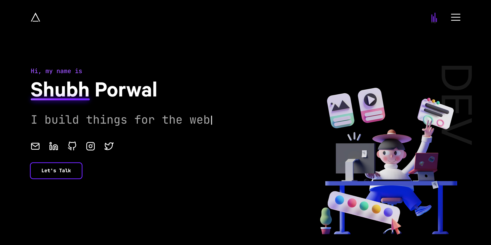

# 🌌 Build Verse

<div align="center">



### Modern Web & Product Engineering Studio Portfolio

[](https://nextjs.org/)
[](https://react.dev/)
[](https://tailwindcss.com/)
[](https://greensock.com/gsap/)
[](./LICENSE.md)

**[✨ Live Website](https://buildverse.dev/)** • **[📬 Get In Touch](#-contact--connect)** • **[🚀 Quick Start](#-getting-started)**

</div>

---

## 📖 Overview

**Build Verse** is an eye-catching, high-performance web and product engineering portfolio crafted with **Next.js**, **React**, **GSAP**, and **Tailwind CSS**. Designed with rich aesthetics, interactive sound effects, custom cursor interactions, dynamic scroll animations, and a curated dark-mode palette.

---

## ✨ Features

- ⚡ **Interactive Hero Experience**: Dynamic typing effects with Typed.js, GSAP staggered reveal animations, and smooth vector Lottie illustrations.
- 🎨 **Sleek Aesthetic Design**: High-contrast dark theme, purple/indigo accents, glassmorphic cards, and custom cursor trail effects.
- 🔊 **Interactive Sound Design (SFX)**: Integrated audio feedback powered by Howler.js for menu toggles, button clicks, and subtle micro-interactions (with a global mute toggle).
- 🛠️ **Skills & Technologies Grid**: Visualized tech stack across frontend, mobile, backend, databases, and engineering workflows.
- 💻 **Interactive Projects Showcase**: Pinned scroll gallery showcasing featured applications with custom gradient themes and live links.
- 💼 **Work Experience & Storytelling**: Smooth scroll-triggered experience breakdowns highlighting milestones and impact.
- 🤝 **Collaboration & Problem Solving**: Animated philosophy highlights emphasizing user experience and modern architecture.
- 📬 **Interactive Contact Section**:
  - Animated paper-plane submission button with GSAP physics.
  - Built-in profanity filter for clean submissions.
  - **Alternative Contact Details**: Direct email channels (`contact@buildverse.dev` and `hello@buildverse.dev`) for immediate outreach.
- 📱 **Fully Responsive & Accessible**: Optimized for mobile, tablet, and desktop viewports with adaptive layouts and reduced-motion support.

---

## 🛠️ Tech Stack

- **Framework**: [Next.js](https://nextjs.org/) (Pages Router)
- **UI Library**: [React 19](https://react.dev/)
- **Styling**: [Tailwind CSS](https://tailwindcss.com/) & SCSS Modules
- **Animations**: [GSAP](https://greensock.com/gsap/) (ScrollTrigger) & [Framer Motion](https://www.framer.com/motion/)
- **Micro-Animations**: [Lottie Web](https://airbnb.io/lottie/) & [Typed.js](https://github.com/mattboldt/typed.js/)
- **Audio / SFX**: [Howler.js](https://howlerjs.com/)
- **Email Delivery**: [@emailjs/browser](https://www.emailjs.com/)
- **Notifications**: [react-hot-toast](https://react-hot-toast.com/)

---

## 🚀 Getting Started

### Prerequisites

Ensure you have [Node.js](https://nodejs.org/) (v20+ or v24 recommended) installed, or [Bun](https://bun.sh/).

### 1. Clone the repository

```bash
git clone https://github.com/buildverse/build-verse.git
cd Build-Verse
```

### 2. Install dependencies

Using npm:
```bash
npm install
```

Or using bun:
```bash
bun install
```

### 3. Environment Variables (Optional)

To enable live email delivery from the contact form, create a `.env.local` file in the root directory:

```env
NEXT_PUBLIC_SERVICE_ID=your_emailjs_service_id
NEXT_PUBLIC_TEMPLATE_ID=your_emailjs_template_id
NEXT_PUBLIC_USER_ID=your_emailjs_public_key
```

### 4. Run the development server

```bash
npm run dev
# or
bun dev
```

Open [http://localhost:3000](http://localhost:3000) with your browser to explore the website.

### 5. Build for production

```bash
npm run build
npm run start
```

---

## 📂 Project Structure

```text
Build-Verse/
├── components/          # Reusable UI & section components
│   ├── About/           # About & engineering philosophy sections
│   ├── Button/          # Custom interactive button component
│   ├── Collaboration/   # Collaboration and highlights marquee
│   ├── Contact/         # Contact form, mailer & alternative details
│   ├── Cursor/          # Custom magnetic cursor
│   ├── Footer/          # Website footer with sound Easter egg
│   ├── Header/          # Fixed navigation bar & sound controller
│   ├── Hero/            # Hero section with Typed.js & Lottie animation
│   ├── Icons/           # Custom SVG social & UI icons
│   ├── Loader/          # Fly-by loader screen & animations
│   ├── Meta/            # SEO metadata, OpenGraph & Schema.org tags
│   ├── Profiles/        # Social media icon bar
│   ├── Projects/        # Pinned horizontal projects gallery
│   ├── Skills/          # Categorized skills matrix
│   └── Work/            # Interactive work timeline
├── pages/               # Next.js Pages router & custom 404
├── public/              # Static assets (favicons, sounds, svgs, images)
├── styles/              # Global styling & fonts
├── utils/               # SFX, intro timers, and logger utilities
├── constants.js         # Site metadata, menu links, contacts & projects
└── README.md            # Project documentation
```

---

## 📬 Contact & Connect

Feel free to connect or reach out regarding projects, collaborations, or inquiries:

- **Primary Contact**: [contact@buildverse.dev](mailto:contact@buildverse.dev)
- **Alternative Contact**: [hello@buildverse.dev](mailto:hello@buildverse.dev)
- **Website**: [https://buildverse.dev](https://buildverse.dev)
- **GitHub**: [@buildverse](https://github.com/buildverse)
- **LinkedIn**: [Build Verse](https://www.linkedin.com/company/buildverse/)
- **X (Twitter)**: [@buildverse](https://x.com/buildverse)

---

## 📄 License

This project is licensed under the [MIT License](LICENSE.md).
